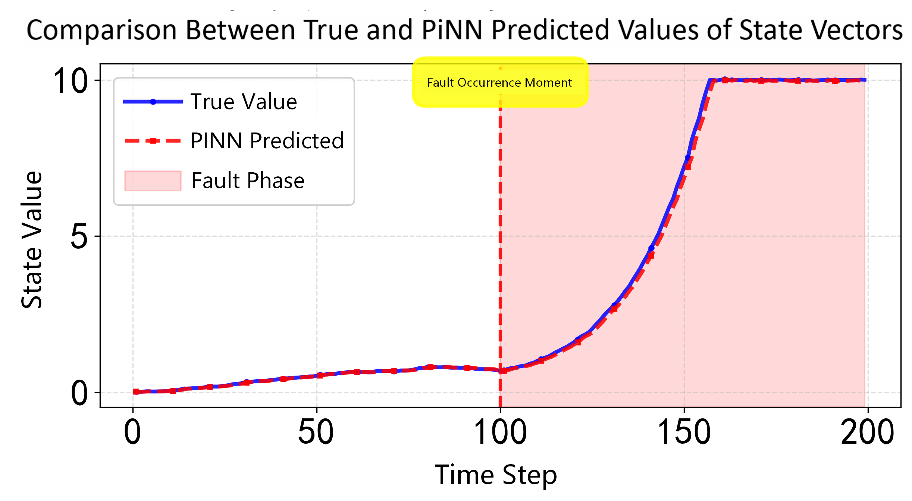
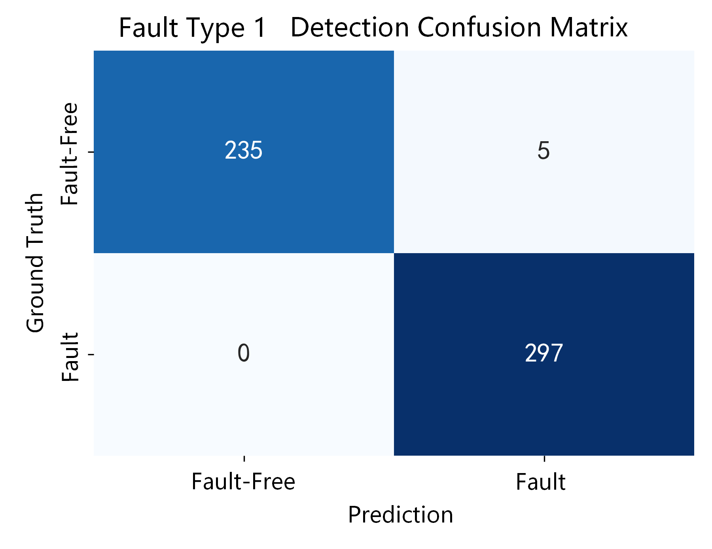
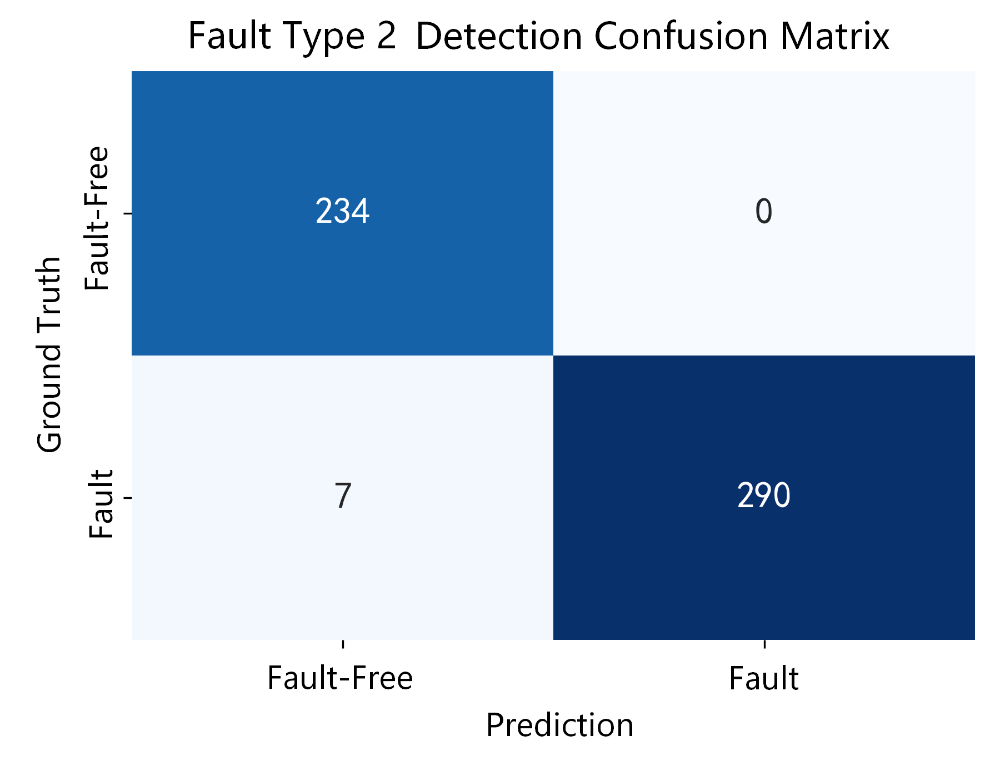
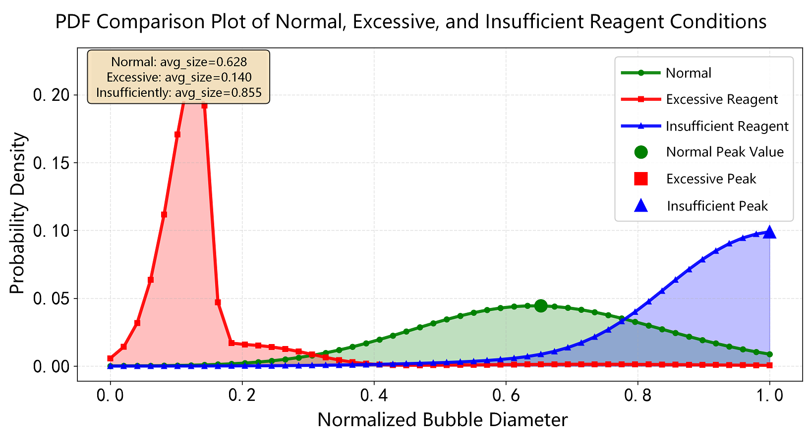
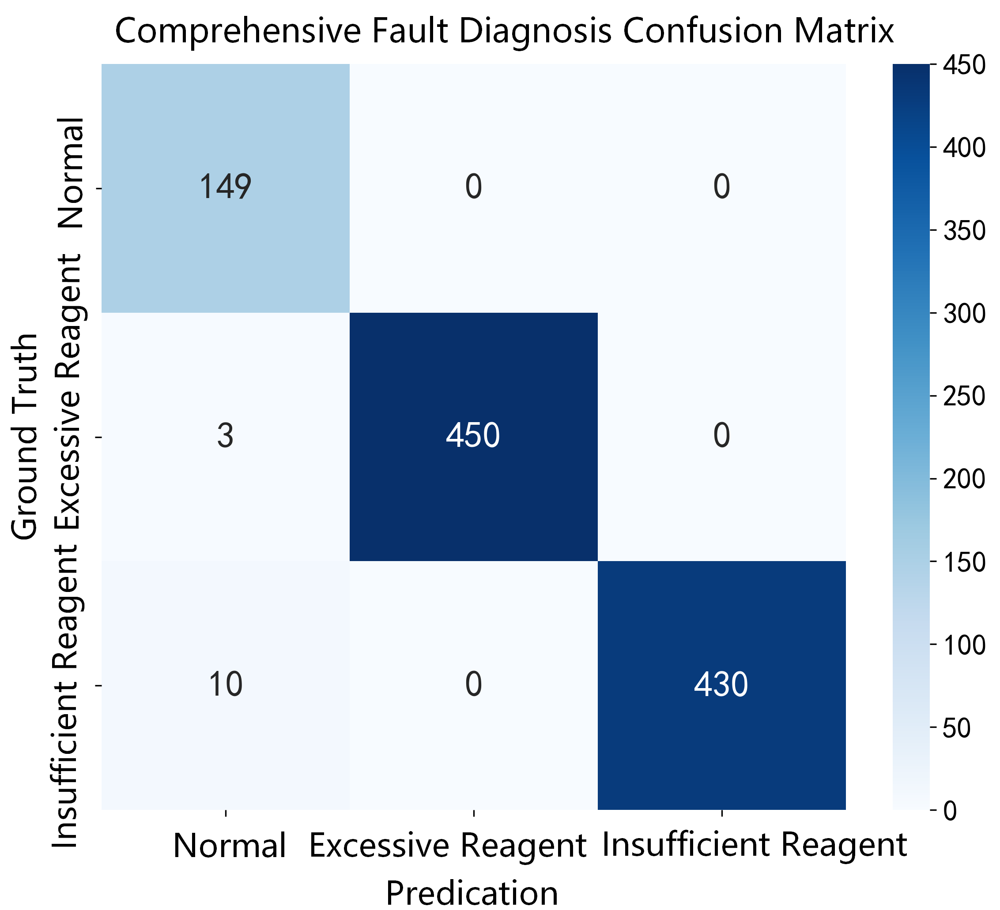

# Physics-Informed Neural Network Learning of Time-Delay Froth Bubble Size Distribution Dynamics for Reagent-Dosage Fault Detection and Diagnosis in Mineral Flotation

This repository provides selected figures and conclusions from the paper:

**Physics-Informed Neural Network Learning of Time-Delay Froth Bubble Size Distribution Dynamics for Reagent-Dosage Fault Detection and Diagnosis in Mineral Flotation**

## Process overview

Mineral flotation separates valuable minerals from ore through gas--liquid--solid interactions. Reagents regulate particle hydrophobicity and froth behavior, so overdosage or underdosage changes the size, shape, and stability of surface bubbles. These changes are delayed and nonlinear because reagent effects, bubble transport, and process dynamics do not occur instantaneously.

The paper follows this workflow:

1. Froth images are processed into bubble-size observations and time-varying bubble size distribution (BSD) probability density functions.
2. B-spline basis functions compress each BSD into a coefficient vector that can be used as a low-dimensional process state.
3. A nonlinear state-space model with state delays and input delays describes the evolution of the coefficient vector under normal and faulty operating conditions.
4. PINN-FDDMF jointly minimizes measurement-fitting loss, delayed-dynamics residual loss, and a smoothness regularizer, combining process data with physical structure.
5. Prediction residuals are used to detect abnormal reagent behavior, and BSD shape features are matched to identify reagent overdosage or underdosage.

The numerical simulation and industrial-data experiments evaluate modeling accuracy, detection performance, diagnosis performance, and robustness to operating-condition drift.

## Main conclusions

- B-spline coefficients provide a compact representation of froth bubble size distribution PDFs.
- A nonlinear dynamic model with state and input delays captures delayed flotation responses.
- The PINN-FDDMF framework combines data fitting, delayed physical dynamics, and smoothness regularization for state and distribution prediction.
- Residual statistics support fault detection under operating-condition drift, while PDF morphology supports diagnosis of reagent overdosage and underdosage.
- On independent industrial copper-flotation test sequences, PINN-FDDMF achieved the highest F1-scores for overdosage (0.990) and underdosage (0.980). PIDMD achieved the highest underdosage accuracy (0.997).

## Representative results

### Modeling accuracy

### Fault detection

### Fault diagnosis comparison

### Industrial-data summary

## Code availability

The code is not included in this public repository. Researchers who need to inspect or request the implementation may contact **424087031@qq.com**.

This repository does not include raw industrial data, video data, trained model weights, or other restricted materials.
